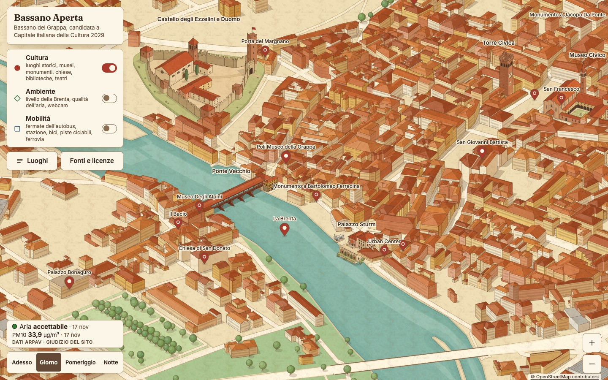
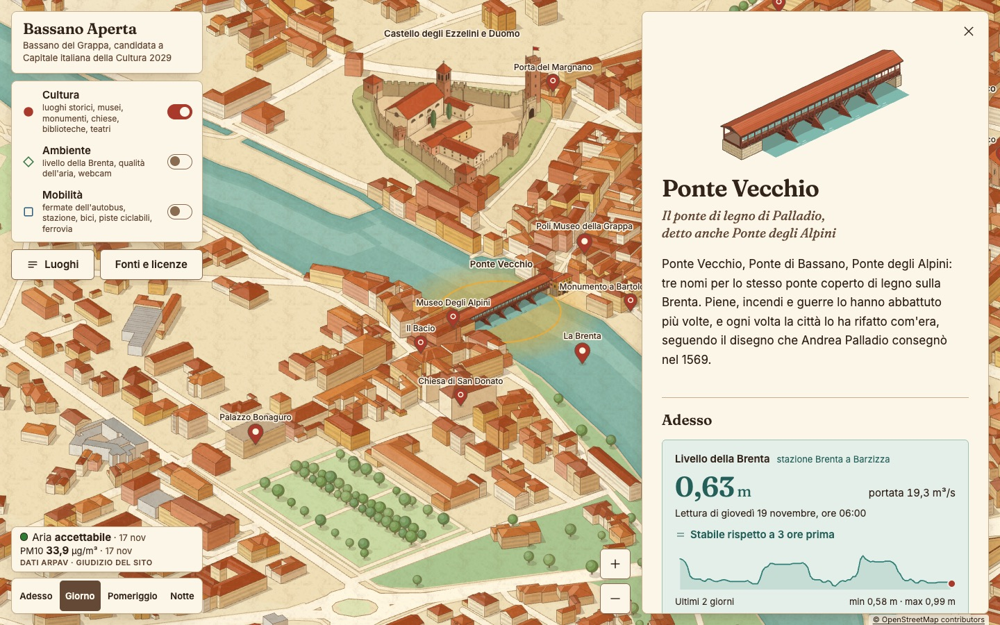
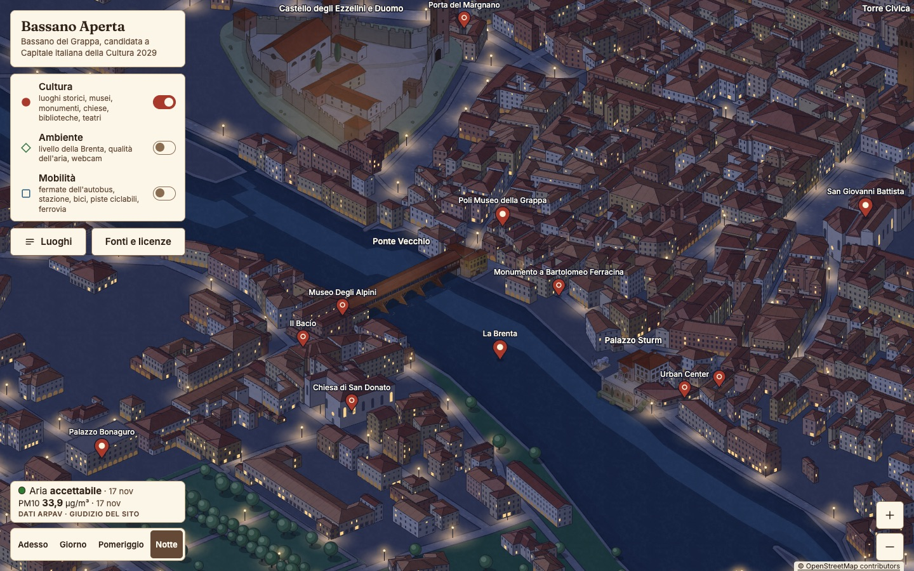
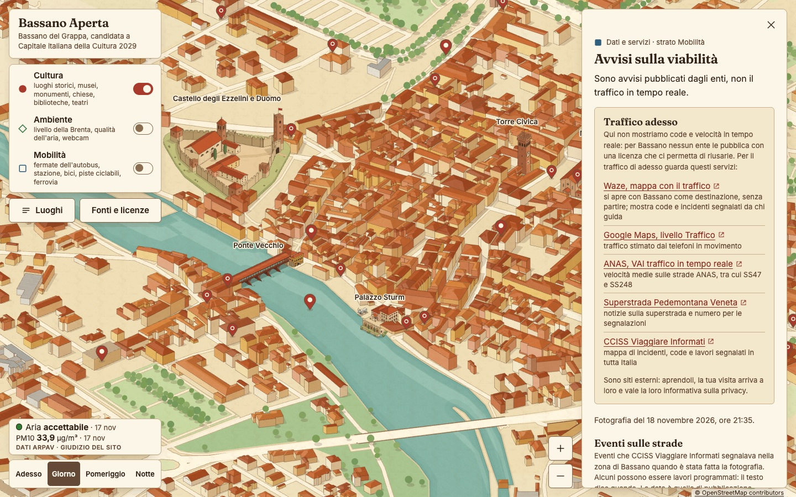

# Bassano Aperta

Una mappa illustrata di Bassano del Grappa, disegnata dal codice, con il racconto dei suoi luoghi
e alcuni dati in diretta. Progetto civico open source, nato attorno alla candidatura di Bassano a
**Capitale italiana della Cultura 2029**.

**Sito:** [bassano.evapassarini.com](https://bassano.evapassarini.com)

È un progetto personale: non è un sito ufficiale del Comune né della candidatura, e non ha scopi
commerciali.

## Perché esiste

Storia, cultura e dati di Bassano esistono già, ma sono sparsi su molti siti diversi: archivi,
musei, enti, Wikipedia, OpenStreetMap. Bassano Aperta prova a metterli in un posto solo, sopra una
mappa che si guarda volentieri, e a dire sempre da dove viene ogni informazione.

## Cosa puoi fare

- Girare per la città in vista isometrica: si trascina, si zooma, e la posizione resta
  nell'indirizzo, così la puoi condividere.
- Aprire uno dei diciannove racconti (diciassette luoghi e due temi), con la linea del tempo, le
  fonti e, dove ci sono, immagini e video.
- Vedere il livello della Brenta in diretta e la qualità dell'aria a Bassano.
- Guardare i prossimi treni alla stazione, con i ritardi dichiarati.
- Accendere lo strato Mobilità e vedere sulla mappa i cartelli delle strade chiuse o con lavori,
  leggere tutti gli avvisi attorno a Bassano e trovare i link ai servizi con il traffico in
  tempo reale.
- Cambiare la luce della mappa: giorno, pomeriggio, notte, oppure quella di adesso.

| La mappa | Un racconto |
| --- | --- |
|  |  |

| La notte | Strade e traffico |
| --- | --- |
|  |  |

## Come leggere il progetto

- **I racconti** sono scritti a partire da fonti lette, e ogni tappa ha il suo link.
- **I dati in diretta** (Brenta e treni) arrivano mentre guardi. Aria e avvisi invece sono
  fotografie aggiornate più volte al giorno: il sito mostra sempre la data e l'ora.
- **Le case** sono un'illustrazione, non un rilievo: forme e posizioni vengono da OpenStreetMap,
  ma le altezze sono quasi tutte stimate. Anche una parte degli alberi e dei lampioni è aggiunta
  dal codice, e il sito lo dice.
- **Quello che si muove** (i treni che entrano in stazione, le macchine, le persone nelle
  piazze, l'acqua della Brenta) è un'illustrazione: non segue orari, traffico né presenze vere.
- **La pagina «Fonti e licenze»** sul sito elenca ogni fonte, con i suoi limiti.

## Regole in breve

- Ogni fatto ha una fonte, con il suo link.
- Se una fonte non risponde, il sito lo dice.
- Immagini solo con licenza libera, con autore e licenza sotto ognuna.
- Per orari e prezzi si rimanda alla pagina ufficiale.
- Italiano semplice, senza gergo.

Dettaglio: [docs/SPEC.md](docs/SPEC.md), «Regole editoriali» e «Media».

## Limiti

- Non è il traffico in tempo reale: il sito mostra gli avvisi pubblicati dagli enti e porta ai
  servizi dove vedere code e velocità.
- I treni sono quelli seguiti in diretta da BusOne: l'elenco può non essere completo.
- Il giudizio a parole sull'aria è un calcolo del sito, non l'indice ufficiale di ARPAV.
- Alcune domande sono ancora aperte: permessi delle fonti, qualche fatto storico, alcune
  immagini. L'elenco è in [docs/SPEC.md](docs/SPEC.md), «Punti aperti».

## Per chi sviluppa

È un sito statico: Vite e TypeScript, nessun framework, nessun server. Serve una versione
recente di Node.js (provato con la 26).

```sh
npm ci
npm run dev      # apre il sito in locale
npm test         # prove automatiche, compreso il controllo di dati e contenuti
npm run build    # controlla i tipi e costruisce il sito in dist/
```

Struttura del repository:

| Cartella | Cosa contiene |
| --- | --- |
| `src/` | il sito: mappa, interfaccia, dati in diretta |
| `content/luoghi/` | i racconti, un file JSON per luogo o tema |
| `public/data/` | i dati della mappa, scaricati dagli script |
| `public/landmarks/` | le illustrazioni dei luoghi simbolo |
| `scripts/` | gli script che scaricano i dati e disegnano le illustrazioni |
| `tests/` | le prove automatiche |
| `docs/` | la specifica e la guida per chi sviluppa |

Come rigenerare i dati, scrivere o correggere un racconto, ridisegnare un luogo simbolo e
pubblicare il sito: [docs/SVILUPPO.md](docs/SVILUPPO.md). La specifica
del sito: [docs/SPEC.md](docs/SPEC.md).

## Contribuire

Gli errori si segnalano nelle
[issue](https://github.com/evapassarini/bassano-aperta/issues): un fatto sbagliato, una fonte
che non torna, un nome scritto male, un problema sul telefono. Per proporre una modifica leggi
[CONTRIBUTING.md](CONTRIBUTING.md). Per un problema di sicurezza segui
[SECURITY.md](SECURITY.md).

## Licenza

Nel repository non c'è una licenza sola.

- Il **codice** è sotto licenza [MIT](LICENSE).
- I **dati** seguono le licenze delle fonti, per esempio OpenStreetMap (© OpenStreetMap
  contributors, ODbL 1.0).
- I **testi dei racconti** e le **illustrazioni** non hanno, per ora, una licenza aperta.
- **Foto e video** restano dei loro autori, con la licenza scritta accanto a ciascuno.

Il dettaglio, fonte per fonte, è nel file [NOTICE](NOTICE).
